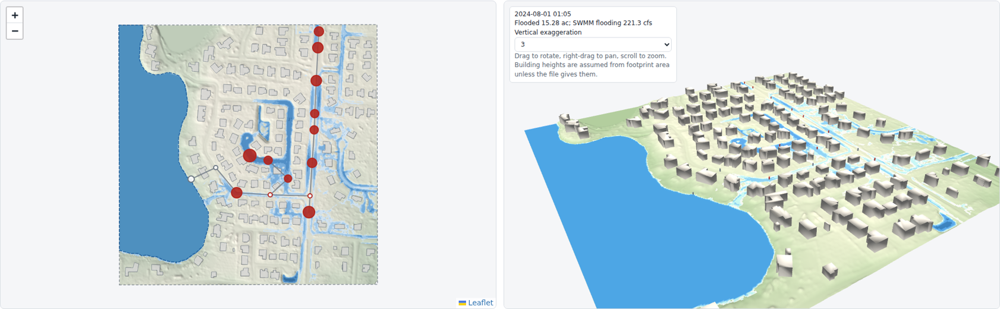

# Flood Simulator

A 2D overland flood simulator that runs in a web browser, with SWMM5 integration. It is one offline HTML file: no installation, no server, and no data leaves the computer.

- **Inputs:**
  - a ground DEM (GeoTIFF);
  - building footprints (GeoJSON);
  - lakes or other level boundaries (GeoJSON);
  - land cover, such as NLCD (GeoTIFF of class codes), for Manning n and imperviousness per cell;
  - soils (GeoJSON with `hsg`, or a GeoTIFF of groups 1–4) for Green-Ampt per cell;
  - a SWMM5 model (`.inp`), with its results (`.out`) for one-way coupling;
  - inlets (GeoJSON points) for two-way coupling: generic, grate, curb or combination (HEC-22 sag equations), with clogging.
- **Water sources:**
  - SWMM node flooding, added at each node;
  - rain on the grid, from a SWMM rain gauge or uniform;
  - water levels held at lakes, ponds or tidal boundaries: from a SWMM node's head, a fixed level, or routed (the lake rises with the water it gains, including SWMM outfalls into it; a routed lake can have a stage-area table and an outlet: a weir, a rating curve, a pipe or a gate, discharging out of the model or into a SWMM node).
- **Engine:** local-inertial shallow-water equations (Bates et al. 2010; de Almeida et al. 2012), with Green-Ampt infiltration. It runs on the GPU (WebGPU) or the CPU, and keeps a water balance at every output step.
- **Results:**
  - animated depth map over a hillshade or basemap;
  - 3D view with buildings and water;
  - maximum velocity and maximum depth × velocity maps, with the cells where the solver capped the flow at critical speed hatched (speed there is a lower bound);
  - charts of flooded area, SWMM exchange, boundary levels and the depth at any point;
  - water-balance table;
  - exports: an 8-band GeoTIFF (maximum depth, maximum water level, time to maximum, maximum velocity, maximum depth × velocity, critical-flow cap flag, time of maximum velocity, duration above a depth × velocity threshold), buildings CSV and SWMM exchange CSV;
  - save a run to a `.fsim.gz` file and open it later without the inputs; the file records the run's provenance (app version, engine settings, input file names and SHA-256 hashes);
  - compare two saved runs on the same grid: change in maximum depth, areas newly flooded and no longer flooded, buildings reached, and how the two runs' settings and input files differ.
- **Help in the page:** a workflow map of the five steps (it shows what is done and jumps to any setting), tooltips on every control (units, default, range), a searchable User Guide, and a first-run tour.



## Quick start

1. Download `dist/FloodSimulator.html` and open it in Chrome or Edge.
2. Under **1. Data**, pick an example and press **Load**, then press **Run**.
3. For your own site:
   - load a DEM in a projected CRS (feet or meters);
   - optionally add buildings, a lake polygon and the SWMM `.inp` and `.out`;
   - choose the water sources and press **Run**.

Large lidar rasters should be clipped and resampled first:

```bash
pip install rasterio geopandas
python python/prep_dem.py --dem lidar.tif --epsg 6438 --bounds XMIN YMIN XMAX YMAX --cell 6 \
    --buildings footprints.geojson --inp model.inp --out mysite/
```

Use `--zfactor 3.2808333333 --zunits ft` to convert meter elevations to US survey feet.

## SWMM integration

| | One way | Two way |
|---|---|---|
| What runs SWMM | You, beforehand. The app reads your `.out`. | The app: EPA SWMM 5.2.4 compiled to WebAssembly, run in step with the 2D. For the two models the C0 check covers, its results are identical to the native engine's (max difference 0). |
| Into the 2D | Node flooding (cfs) at each node's location | Node overflow every coupling interval |
| Back into SWMM | Nothing | Surface water through inlets: weir flow while the node is below its rim, orifice flow when it is surcharged, limited each step by the water in the cell, with SWMM sent the volume actually taken (independent of cell size). Inlets come from an inlets file (each at its own cell, with its own size), or default to one at each manhole. |
| Level boundaries | Storage or outfall head from the `.out` | Live storage or outfall head |
| Outputs | Results in the app | Also the coupled SWMM report (`.rpt`) and results (`.out`) |

Notes:
- **Coordinates:** node coordinates in the `.inp` must be in the DEM's CRS.
- **Placement:** a node on a building is moved to the nearest open cell within 30 ft. Nodes that cannot be placed are reported, not dropped silently:
  - one way: their flooding is not added;
  - two way: their overflow is tallied as lost.
- **Two-way settings:**
  - the coupling is explicit, with a default interval of 30 s; the 2D sees SWMM's response one interval later;
  - `ALLOW_PONDING` is forced to `NO` in the in-memory copy so that overflow reaches the surface, and the app says so;
  - in the inlets file, each point names its junction (`node`) and can set `weir_length_ft`, `orifice_area_sqft`, `cw`, `co` and `rim_ft`. The defaults in the app apply to anything not given; without `rim_ft` the crest is the SWMM rim of the node, as for a default inlet. An inlet flagged `on_grade` with its street's `cross_slope` and `long_slope` uses the HEC-22 on-grade interception path instead of the sag equations.
  - when the 2D run ends before SWMM's, the inlet inflow is reset to zero and SWMM finishes on its own, so its report holds only what the inlets took.
- **Double counting:** rain on the grid together with SWMM counts runoff twice where the grid overlaps SWMM subcatchments. The app warns about this.

The WebAssembly build of SWMM is `vendor/swmm-wasm/swmm5.js`. It was built from the EPA source (public domain), tag v5.2.4, with Emscripten 3.1.64; see `tools/build_swmm_wasm.sh`.

## Repository

| Path | Contents |
|---|---|
| `src/engine/flood2d.js` | 2D engine: CPU and WebGPU (WGSL) back ends with the same arithmetic, point inflows, level boundaries, water balance |
| `src/io/swmm.js` | SWMM5 `.inp` parser and binary `.out` reader, rain-gauge series |
| `src/core/model.js` | DEM to grid, buildings to walls, boundary polygons, one-way SWMM coupling, GeoTIFF writer |
| `src/app/` | Page, worker, 3D view, help |
| `tools/build.py` | Builds `dist/FloodSimulator.html` with every library inlined |
| `python/` | `prep_dem.py` (DEM and buildings prep), `make_synthetic.py`, `make_public_demo.py`, `make_landcover_example.py`, `make_inlets_example.py`, `make_winter_haven_demo.py` (real site from public data), `compare_icpr_winter_haven.py` (compares the Winter Haven runs with the City's ICPR inundation) |
| `examples/` | Synthetic street sewer (US and SI units) and a public-data demo |
| `tests/` | Node tests (engine, SWMM readers, model builder), Python reference generators, browser tests |

## Tests

```bash
npm --prefix tools install          # geotiff for the node tests (once)
node tests/node/test_solver_core.js
node tests/node/test_solver_guards.js
node tests/node/test_sources.js
node tests/node/test_swmm.js
node tests/node/test_model.js
node tests/node/test_couple2way.js
node tests/node/test_lakes.js
node tests/node/test_velocity.js
node tests/node/test_landcover.js
node tests/node/test_worker.js
node tests/node/test_results_io.js
python tools/build.py && python tests/browser/test_app.py
python tools/check_claims.py   # the five figures STATUS quotes from the suites, checked against what they print; add --browser-log <log> to gate the browser figure (B20) too, as CI does
```

The SWMM readers are checked against the EPA SWMM 5.2 engine (`swmm-toolkit`), and the grid builder against rasterio.

## Data in the examples

**Synthetic street sewer:**
- an invented place and model;
- placed in a real CRS only so the files are valid.

**Public-data demo:**
- ground from USGS 3DEP lidar (2018 FL Peninsular; public domain);
- buildings from Microsoft Building Footprints (ODbL 1.0);
- streets from US Census TIGER/Line (public domain).

The storm sewer in the public-data demo was generated from the street centerlines by `make_public_demo.py`. It is illustrative and is **not** the real drainage system of that place.

**Real site, Winter Haven, Florida (Lake Martha):** `python python/make_winter_haven_demo.py examples/winter_haven` downloads and builds it; the data are not stored in the repository.
- storm sewer: City of Winter Haven stormwater inventory (public ArcGIS Online view): 145 pipes with inverts and sizes, 84 curb and grate inlets;
- ground: USGS 3DEP 1 m lidar (2018 FL Peninsular), resampled to 3 ft; lakes: USGS NHD, held at the lidar water surface;
- buildings: FEMA USA Structures; land cover: NLCD 2021; soils: USDA SSURGO; rain: NOAA Atlas 14, 25-year 24-hour (7.69 in) as a nested storm.
The SWMM model is built from the inventory as is (rims from the lidar, no subcatchments); `build_report.json` lists every assumption and data gap. It is a test of the method on real data, not a calibrated model of the city's system.

## License

MIT (see `LICENSE`). Bundled libraries keep their own licenses (`vendor/*/LICENSE*`): Leaflet (BSD-2), three.js (MIT), Plotly.js (MIT), geotiff.js (MIT), proj4js (MIT). Two bundled items carry no LICENSE file: EPA SWMM (public domain; see `vendor/swmm-wasm/NOTICE`) and the CRS list (a file, `vendor/crs_catalog.json`, from the PROJ database, MIT/X).
